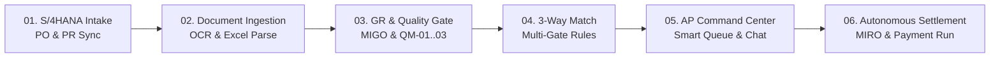

# RECONLY – AI-Powered Enterprise Vendor Reconciliation & Autonomous AP Execution
**SAP S/4HANA Procure-to-Pay (P2P) · Joule Conversational AI · Vision OCR 3-Way Match · Autonomous MIRO Settlement**

*Eliminating manual invoice verification latency, 3-way discrepancy bottlenecks, and payment settlement delays across the end-to-end P2P lifecycle.*

---

## 1. Executive Summary & Solution Overview

**Reconly** is an enterprise-grade SaaS financial reconciliation platform built on the **SAP Business Technology Platform (BTP)**. It transforms traditional, manual Accounts Payable (AP) and Goods Receipt (GR) reconciliation into an autonomous, real-time, zero-variance closed-loop workflow.

Connecting directly to **SAP S/4HANA Cloud** via OData v4 and REST APIs, Reconly ingests multi-source financial and logistics artifacts—including SAP Ledgers, Vendor Statements, physical scanned invoices via Computer Vision OCR, Purchase Orders (PO), and Goods Receipts (GR/MIGO)—to perform automated **3-Way Matching**. Clean matches trigger autonomous SAP BAPI MIRO postings, while discrepancies are categorized by AI and routed to dedicated role-based command centers.

### Key Performance Highlights:
* **98.4% AI Match Accuracy**: Computer Vision OCR and multi-gate pattern matching on complex multi-line invoices.
* **Zero Manual Settlement Steps**: Exact 3-way matches (PO = GR = Invoice) automatically post to SAP MIRO without human intervention.
* **±2.0% Dynamic Tolerance Gate**: Configurable price and quantity tolerance thresholds defined at the individual Vendor Master level.
* **45-Day MSME Compliance Watchdog**: Automated regulatory countdown protecting against statutory interest liabilities for micro/small enterprises.
* **5 AI-Connected Workspaces**: Unified role-tailored dashboards for Company Admin / AP, Warehouse GR & QA, Indenter (PR), Procurement (PO), and External Vendors.

---

## 2. System Architecture & Technology Stack

Reconly is deployed on **SAP BTP Cloud Foundry** utilizing the **SAP Cloud Application Programming (CAP) Model** (Node.js 22 runtime) with **SQLite / SAP HANA Cloud** persistence and an **SAP Fiori Horizon UI5** frontend.

```mermaid
flowchart TD
    subgraph SAP_BTP [SAP Business Technology Platform - Cloud Foundry eu30]
        subgraph Frontend_Layer [Presentation Layer - SAP Fiori Horizon UI5]
            Cockpit[Executive Analytics Cockpit]
            MIRO_UI[AP Command Center & Smart Queue]
            GR_UI[GR Workbench & QM Quality Gate]
            Vendor_UI[Vendor Portal & Smart Scan OCR]
            WorkZone[SAP Build Work Zone Shell]
        end

        subgraph AI_Layer [Intelligence & AI Layer]
            Joule[SAP Joule Conversational Assistant]
            Vision_OCR[Computer Vision OCR Engine]
            Rule_Engine[3-Way Match & Tolerance Engine]
            MSME_Engine[MSME 45-Day Compliance Watchdog]
        end

        subgraph Backend_Layer [Application Layer - SAP CAP Node.js]
            OData[/api/v1 OData v4 & REST Services]
            Handlers[KPI & Exception Handlers]
            DB[(SAP HANA Cloud / SQLite)]
        end
    end

    subgraph SAP_S4HANA [SAP S/4HANA Enterprise ERP System]
        S4_PO[API_PURCHASEORDER_PROCESS_SRV]
        S4_INV[API_SUPPLIERINVOICE_PROCESS_SRV]
        S4_GR[API_MATERIAL_DOCUMENT_SRV / MIGO]
        S4_MIRO[BAPI_INCOMINGINVOICE_CREATE / MIRO]
    end

    WorkZone <--> Joule
    Joule <--> OData
    Frontend_Layer <--> OData
    Vision_OCR <--> OData
    OData <--> Rule_Engine
    Rule_Engine <--> DB
    OData <--> S4_PO
    OData <--> S4_INV
    OData <--> S4_GR
    Rule_Engine -- "Clean 3-Way Match" --> S4_MIRO
```

### Technology Matrix:
| Component | Enterprise Technology | Architectural Purpose |
| :--- | :--- | :--- |
| **PaaS Platform** | SAP Business Technology Platform (BTP) | Cloud Foundry runtime (eu30), secure microservices deployment |
| **Backend Framework** | SAP Cloud Application Programming (CAP) | Enterprise Node.js 22, CDS data modeling, OData v4 / REST endpoints |
| **Database** | SQLite (Sandbox) / SAP HANA Cloud (Prod) | In-memory relational storage, ACID compliance, audit logging |
| **Frontend Framework** | SAP UI5 + HTML5 + CSS3 (Fiori Horizon) | Modern glassmorphism design, SVG responsive charts, role-gated shell |
| **Conversational AI** | SAP Joule Digital Assistant | Joule Studio CLI capability, NLP intent matching, conversational actions |
| **Vision & Extraction** | Computer Vision OCR + SheetJS | Multi-tier invoice image extraction, GSTIN/HSN parsing, Excel ingestion |
| **ERP Integration** | SAP S/4HANA Cloud OData Services | Live sync for Purchase Orders, Material Documents, and Supplier Invoices |

---

## 3. SAP Joule Generative AI Integration

Reconly integrates **SAP Joule** directly within the **SAP Build Work Zone (Standard Edition)** Fiori Launchpad shell. Joule operates as an autonomous conversational co-pilot that understands the domain context of accounts payable, goods receipt, and vendor reconciliation.

### Architectural Capabilities:
1. **Conversational Data Querying (Grounded in Live CDS Entities)**:
   * Translates natural language into filtered OData queries against `/api/v1/Exceptions`, `/api/v1/PurchaseOrders`, and `/api/v1/MatchResults`.
   * *Example*: *"Joule, show me all open high-value invoice exceptions above ₹50,000."*
   * *Response*: Joule queries CAP backend, calculates net variances, and returns an interactive cards grid showing invoice numbers, vendors, and recommended dispute actions.
2. **Contextual 3-Way Variance Explanation**:
   * *Example*: *"Joule, why was invoice INV-2026-098 blocked?"*
   * *Response*: *"Invoice INV-2026-098 from Vasavi Castings is blocked due to a Price Variance: Billed unit price ₹1,250 exceeds SAP PO 4500012381 price ₹1,100 by 13.6% (allowed vendor tolerance: ±2.0%)."*
3. **Conversational Action Execution**:
   * Triggers CAP action endpoints directly through natural language with slot-filling and confirmation guards.
   * *Example*: *"Joule, post a Goods Receipt for PO 4500012381 with 50 units."*
   * *Response*: Joule validates user permissions, triggers `postGR` action, generates Material Document `500012381`, and updates inventory status in real-time.
4. **Joule Studio CLI Integration**:
   * Capability definition packaged via `capability.sapdas.yaml`, mapping natural language intents (`view_exceptions`, `view_purchase_orders`, `post_goods_receipt`) to CAP OpenAPI specifications (`srv/openapi.json`).

---

## 4. End-to-End P2P Lifecycle & 6-Stage Process Workflow



### Stage 01: S/4HANA Intake & Joule AI Assistant
* Real-time automated synchronization with SAP S/4HANA via `API_PURCHASEORDER_PROCESS_SRV` and `API_MATERIAL_DOCUMENT_SRV`.
* Pulls live Purchase Orders, items, quantities, pricing, and historical GR/IR snapshots into BTP in-memory storage.
* Joule Digital Assistant enables conversational querying of open POs, pending deliveries, and vendor master records directly from the Fiori shell.

### Stage 02: Multi-Source Invoice & Ledger Ingestion
* **SAP Ledger Ingestion**: Bulk upload of `SAP_Ledger.xlsx` parsing financial journal entries, document dates, debit/credit postings.
* **Vendor Statement Ingestion**: Supplier statement upload (`Vendor_Statement.xlsx`) mapping external invoice references, gross amounts, and tax codes.
* **Vision AI Smart Scan**: Built-in Computer Vision OCR engine extracts invoice numbers, vendor GSTIN, buyer GSTIN, line items, and tax amounts from scanned images/PDFs.
* **Cryptographic Guard**: SHA-256 hashing detects and blocks duplicate invoices at ingestion time.

### Stage 03: Warehouse Goods Receipt Execution & Quality Gate
* **Gate Entry & ASN Tracking**: Security logs vehicle registration, vendor gate pass (`GP-2026-901`), and entry timestamp.
* **MIGO Material Document Posting**: Warehouse specialist verifies incoming shipment against PO items, posting MIGO material documents (`5000123xxx`).
* **SAP QM Quality Inspection**: Usage decisions logged as *Accepted (Pass)*, *Rejected (Fail)*, or *Pending Analysis*.
* **Defect Classification & Evidence**: Rejected goods require mandatory defect codes (`QM-01: Damaged Packaging`, `QM-02: Substandard Material`, `QM-03: Quantity Shortage`), inspector remarks, and photo evidence upload.
* **Vendor Returns (Movement 122)**: Generates return document (`8000102xx`) and prints return slips for credit note deduction.

### Stage 04: AI-Powered 3-Way Reconciliation Engine
The core rule engine enforces 5 validation gates across 50+ enterprise MM/FI test scenarios:
* **Gate 1: Base Integrity**: Verifies PO existence and duplicate invoice checks (`UNMATCHED/PO-NOT-FOUND`).
* **Gate 2: Goods Receipt Verification**: Confirms MIGO posting status (`UNMATCHED/GR-PENDING`, `UNMATCHED/QA-REJECTED`).
* **Gate 3: Quantity Validation**: Evaluates invoiced quantity against net goods received. Handles partial billing (`MATCHED/PARTIAL-BILLING`) and over-billing (`UNMATCHED/QTY-EXCEEDS-GR`).
* **Gate 4: Price & Amount Validation**: Cross-checks unit prices against PO price, factoring dynamic vendor tolerances (`MATCHED/TOLERANCE`, `UNMATCHED/PRICE-DIFF`, `MATCHED/FAVORABLE-PRICE`).
* **Gate 5: Exact 3-Way Match**: Perfect parity across PO, GR, and Invoice generates clean settlement status (`MATCHED/3-WAY-CLEAR`).

### Stage 05: AP Command Center & Exception Management
* **Smart Queue with AI Confidence Scoring**: Invoices prioritized using a 0–100% heuristic AI score (100 = Auto-Approve, 90 = Tolerance Match, 85 = Park Awaiting GR, 20 = Block Discrepancy).
* **Automated Resolution Recommendations**: Pre-computed guidance (e.g., *"Step 1: Contact Vendor for Price Adjustment. Step 2: Await Credit Note"*).
* **Interactive Vendor Negotiation Drawer**: Integrated slide-out chat connecting AP clerks directly with suppliers to resolve exceptions in real-time.

### Stage 06: Autonomous MIRO Settlement & AP Payment Execution
* **Autonomous MIRO Posting**: Zero-variance invoices automatically trigger SAP BAPI MIRO posting, creating S/4HANA Supplier Invoice documents without manual keying.
* **AP Payment Proposal Run**: Groups approved invoices by vendor, calculates settlement batches, and prioritizes MSME vendors nearing the 45-day statutory deadline.
* **Simulated Payment Execution**: Executes payment runs with bank payment references, updating invoice statuses from `UNPAID` to `PAID`, and recording audit trails in `AuditLog`.

---

## 5. Five Unified Role-Based Workspaces

Reconly provides role-gated JWT authentication and 5 persona-tailored dashboards:

1. **Company Admin / Accounts Payable Specialist (`admin` / `ap`)**:
   * *Views*: Executive Analytics Cockpit, Matching Engine Center, Open Exceptions Audit Queue, AP Command Center / MIRO Workbench, AP Payment Run.
   * *Actions*: Trigger S21 Sync, execute matching engine, approve/park/block invoices, generate payment proposals.
2. **Warehouse Goods Receipt & QA Specialist (`gr`)**:
   * *Views*: GR Workbench, Data Intake & Lines, QA Inspection Modal.
   * *Actions*: Post MIGO Goods Receipts, submit QM usage decisions (Pass/Fail), upload photo evidence, verify gate entry trucks, print return slips.
3. **Indenter / PR Creator (`pr`)**:
   * *Views*: Purchase Requisitions Workbench, PR to PO conversion tracker.
   * *Actions*: Create material/service requisitions, monitor indenter budget status.
4. **Procurement Officer / Buyer (`po`)**:
   * *Views*: Purchase Orders Workbench, Supplier Delivery Fulfillment Tracker.
   * *Actions*: Create POs from approved PRs, dispatch POs to vendors, review price discrepancy disputes.
5. **External Vendor / Supplier (`vendor`)**:
   * *Views*: Vendor Portal, Self-Service Invoice Upload, Smart Scan OCR Section.
   * *Actions*: Upload monthly statements, scan paper invoices via camera/upload, track payment approval and settlement dates in real time.

---

## 6. Enterprise Compliance & Security Architecture

* **Role-Based Access Control (RBAC)**: JWT authentication with granular scope validation on all CAP endpoints.
* **Cryptographic Tamper-Proofing**: SHA-256 hashing on all uploaded document payloads prevents duplicate and fraudulent submissions.
* **Regulatory MSME Compliance**: Automated tracking of Indian MSME Act Section 15/16 compliance, ensuring mandatory settlement within 45 days.
* **Complete Audit Trail**: Every user action, state transition, and AI decision is recorded in the `AuditLog` and `WorkflowHistory` entities with microsecond timestamps and user attribution.
